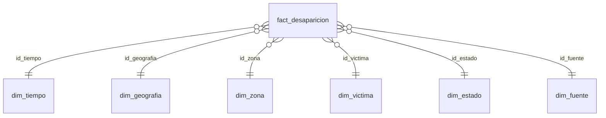

# Diccionario del modelo multidimensional — Etapa 5

Modelo estrella con 1 tabla de hechos y 6 dimensiones, implementado en SQLite
(`data/olap/modelo_estrella.db`). Construido por el Integrante 1 (turno 1).

## ⚠️ Corrección a las cifras del reparto de tareas

El documento de reparto de tareas propone 282.597 registros (205.812 Medicina Legal +
76.785 SIEVCAC), pero esas cifras corresponden a la tabla `dbo.desaparecidos_final` de
la **Etapa 3 (SSIS)**, que excluye los registros sin fecha completa. La decisión común #1
del mismo documento dice explícitamente usar `data/processed/dataset_tratado.csv`
(Etapa 2) como fuente, y el propio diseño del modelo define `id_tiempo = 0` para "sin
fecha" — lo que solo tiene sentido si esos registros **se incluyen**, no se excluyen.

Verificado contra `dataset_tratado.csv`, filtrando `fuente` en {Medicina Legal, SIEVCAC}
y `unidad_de_analisis = "persona"`:

| | Reparto de tareas | Real (usado en este modelo) |
|---|---|---|
| Medicina Legal (SIRDEC) | 205.812 | **205.938** |
| SIEVCAC (CNMH) | 76.785 | **82.458** |
| Total | 282.597 | **288.396** |
| % Medicina Legal que sigue desaparecida | 63,7 % | 63,7 % (coincide) |
| % SIEVCAC que sigue desaparecida | 86,9 % | 87,3 % |

Este modelo usa las cifras reales (288.396). Avisar al resto del grupo, porque el 282.597
aparece también en la lista de verificación del reparto.

## 1. Unidad de análisis frente a granularidad

- **Unidad de análisis del proyecto:** la persona desaparecida en Colombia (igual que en
  la Etapa 4).
- **Granularidad de la tabla de hechos:** una persona **registrada por una fuente**. Una
  misma persona puede existir en Medicina Legal y en SIEVCAC a la vez — el dataset no
  tiene una llave para identificarlo, así que **nunca se suman las dos fuentes como si
  fueran una sola población** (ver medida "Personas registradas" más abajo, y la
  dimensión `dim_fuente`, que siempre queda disponible para filtrar o desagregar).
- **Registros usados:** 288.396 (205.938 Medicina Legal + 82.458 SIEVCAC), el resultado
  tratado en la Etapa 2, filtrado a las dos fuentes nacionales con unidad de análisis
  "persona". Se excluyen IOM y ACLED porque su fila es un evento agregado (puede
  representar más de una persona); incluirlas rompería la granularidad de "una fila = una
  persona en una fuente" que exige este modelo. Esa exclusión se documenta como
  limitación, no se oculta.

## 2. Limitaciones de calidad que pueden afectar los resultados

| Limitación | Alcance | Dónde se ve en el modelo |
|---|---|---|
| Fecha sin año conocido | 4.262 personas (1,48 %) | `dim_tiempo`, miembro `id_tiempo = 0` ("Sin información") |
| Año conocido pero mes desconocido | 818 personas (0,28 %) | `dim_tiempo`, miembros `id_tiempo = AAAA00` ("Mes desconocido"); cuentan en el año y en `periodo_acuerdo`, no en trimestre/mes |
| SIEVCAC sin sexo registrado | 2.986 personas | `dim_victima`, `sexo = "Sin información"` |
| Personas en el extranjero sin código DANE de municipio | 1.648 (1.581 "Desaparecidos en el extranjero" + 67 "Exterior") | `dim_geografia`, `codigo_dane_municipio` nulo |
| SIEVCAC sin código DANE de departamento (la fuente no lo reporta) | 82.458 (toda SIEVCAC) | `dim_geografia`, `codigo_dane_departamento` nulo |
| `departamento` en dos formatos (Medicina Legal en texto normal, SIEVCAC en MAYÚSCULAS) | Toda SIEVCAC | Se normaliza en el script de carga (`scripts/cargar_modelo_estrella.py`) antes de construir `dim_geografia`; ver Etapa 4 donde se detectó |
| Posible traslape entre fuentes | No cuantificable con los datos disponibles | `dim_fuente`; los indicadores por fuente nunca se suman entre sí como personas únicas |
| `calidad_victima` solo existe en SIEVCAC; `zona_hecho` solo existe en Medicina Legal | — | Para la fuente que no reporta el atributo, el valor queda "Sin información" (no vacío) |

## 3. Tabla de hechos

### `fact_desaparicion`

Grano: **una fila = una persona registrada por una fuente** (Medicina Legal o SIEVCAC).

| Campo | Tipo | PK/FK | Descripción | Ejemplo | Variable de origen |
|---|---|---|---|---|---|
| `id_hecho` | INTEGER | PK | Clave sustituta autoincremental | `1` | generado |
| `id_registro` | TEXT | — (dimensión degenerada) | Identificador original del registro, único en el dataset tratado; permite rastrear hasta el CSV | `ML-60176`, `SIEVCAC-1022578` | `id_registro` |
| `id_tiempo` | INTEGER | FK → `dim_tiempo` | Mes del hecho, o 0 si no hay fecha | `200212` | `anio`, `mes` |
| `id_geografia` | INTEGER | FK → `dim_geografia` | Departamento/municipio del hecho | — | `departamento`, `municipio`, códigos DANE |
| `id_zona` | INTEGER | FK → `dim_zona` | Zona del hecho (solo Medicina Legal) | — | `detalle` (Medicina Legal) |
| `id_victima` | INTEGER | FK → `dim_victima` | Sexo y calidad de la víctima | — | `sexo`, `detalle` (SIEVCAC) |
| `id_estado` | INTEGER | FK → `dim_estado` | Estado actual de la persona | — | `estado_victima` |
| `id_fuente` | INTEGER | FK → `dim_fuente` | Fuente y tipo de evento | — | `fuente`, `tipo_evento` |
| `num_personas` | INTEGER | — | Siempre 1 en este modelo (cada fila ya es 1 persona) | `1` | constante |
| `flag_sigue_desaparecida` | INTEGER (0/1) | — | 1 si `estado_victima = "Desaparecido"` | `1` | derivado de `estado_victima` |
| `flag_aparecio_viva` | INTEGER (0/1) | — | 1 si `estado_victima = "Aparecido con vida"` | `0` | derivado de `estado_victima` |
| `flag_aparecio_sin_vida` | INTEGER (0/1) | — | 1 si `estado_victima = "Aparecido sin vida"` | `0` | derivado de `estado_victima` |

`id_registro` es único por fila (288.396 valores distintos, verificado), así que funciona
como la clave natural de trazabilidad sin ser la PK técnica de la tabla.

## 4. Dimensiones

### `dim_tiempo` — jerarquía `anio → trimestre → mes`

| Campo | Tipo | Descripción | Dominio real |
|---|---|---|---|
| `id_tiempo` | INTEGER PK | `AAAAMM`; `AAAA00` si se conoce el año pero no el mes; `0` = ni año ni mes | `0`, `193000`, `193001`…`202606` |
| `anio` | INTEGER | Año del hecho | 1930–2026; `NULL` solo si `id_tiempo = 0` |
| `semestre` | INTEGER | 1 o 2 | `NULL` si no hay mes |
| `trimestre` | INTEGER | 1 a 4 | `NULL` si no hay mes |
| `mes` | INTEGER | 1 a 12 | `NULL` si no se conoce (incluye `nombre_mes = "Mes desconocido"` cuando sí hay año) |
| `nombre_mes` | TEXT | Nombre del mes en español | "enero"…, `"Mes desconocido"`, `NULL` si `id_tiempo = 0` |
| `periodo_acuerdo` | TEXT | Periodo comparable frente al Acuerdo de Paz | `"Antes (2007-2016)"`, `"Después (2017-2025)"`, `"Fuera de rango comparable"`, `"Sin información"` |

**Por qué esta jerarquía:** permite pasar de un resumen anual a trimestral o mensual sin
perder la relación de agrupación (un mes pertenece a un único trimestre, un trimestre a
un único año). `periodo_acuerdo` solo se marca para 2007-2016 y 2017-2025 (9 años cada
uno, periodos equivalentes); 2026 queda fuera por estar incompleto, y lo anterior a 2007
queda fuera porque la Etapa 4 ya estableció ese rango como el comparable.

**Dos niveles de "falta información", no uno solo:** 4.262 personas (1,48 %) no tienen
año registrado y caen en `id_tiempo = 0` — esas sí quedan fuera de cualquier conteo anual
o por `periodo_acuerdo`, porque no hay año que agrupar. Otras 818 personas sí tienen año
pero no mes; agruparlas también en la clave 0 les habría borrado el año, dañando el
conteo anual y el de `periodo_acuerdo` (que solo necesita el año). Por eso tienen su
propio miembro `id_tiempo = AAAA00` por cada año: el roll-up a año y a `periodo_acuerdo`
las incluye correctamente, y solo desaparecen al bajar a trimestre o mes, donde de verdad
no hay dato.

### `dim_geografia` — jerarquía `macro_region → departamento → municipio`

| Campo | Tipo | Descripción | Dominio real |
|---|---|---|---|
| `id_geografia` | INTEGER PK | Clave sustituta | — |
| `macro_region` | TEXT | "Sur" si `departamento` ∈ {Nariño, Cauca, Putumayo, Caquetá, Huila}, si no "Resto" | `"Sur"`, `"Resto"` |
| `codigo_dane_departamento` | TEXT | Código DANE de 2 dígitos | `NULL` en SIEVCAC y en casos del extranjero |
| `departamento` | TEXT | Nombre normalizado (formato título, sin mezclar mayúsculas) | 35 departamentos + "Desaparecidos En El Extranjero" + "Exterior" |
| `codigo_dane_municipio` | TEXT | Código DANE de 5 dígitos | `NULL` en 1.648 casos del extranjero |
| `municipio` | TEXT | Nombre normalizado | — |

**Por qué esta jerarquía:** departamento agrupa municipios de forma natural (1:N real,
no inventada) y macro-región agrupa departamentos según la pregunta territorial ya
definida en la Etapa 4. Se normaliza el texto de `departamento`/`municipio` al cargar,
porque Medicina Legal y SIEVCAC usan formatos de mayúsculas distintos para el mismo
nombre (detectado en la Etapa 4).

### `dim_zona` — sin jerarquía (un solo nivel)

| Campo | Tipo | Dominio real |
|---|---|---|
| `id_zona` | INTEGER PK | — |
| `zona_hecho` | TEXT | `"Cabecera municipal"`, `"Parte rural (vereda y campo)"`, `"Centro poblado (corregimiento, inspección de policía y caserío)"`, `"Sin información"` |

Viene de la columna `detalle` del dataset tratado, pero **solo para Medicina Legal**; en
SIEVCAC esa misma columna guarda otra cosa (ver `dim_victima`), así que a todas las
filas de SIEVCAC se les asigna `id_zona = 0` ("Sin información") en la carga.

### `dim_victima` — sin jerarquía

| Campo | Tipo | Dominio real |
|---|---|---|
| `id_victima` | INTEGER PK | — |
| `sexo` | TEXT | `"Hombre"` (213.733), `"Mujer"` (71.677), `"Sin información"` (2.986) |
| `calidad_victima` | TEXT | `"Civil"` (81.055), `"Combatiente"` (1.365), `"Sin información"` (38 + todo Medicina Legal) |

`calidad_victima` viene de `detalle` en SIEVCAC; en Medicina Legal, que no reporta esa
variable, queda `"Sin información"`.

### `dim_estado` — jerarquía `grupo_desenlace → estado_victima`

| Campo | Tipo | Dominio real |
|---|---|---|
| `id_estado` | INTEGER PK | — |
| `grupo_desenlace` | TEXT | `"Sin resolver"`, `"Resuelto"` |
| `estado_victima` | TEXT | `"Desaparecido"` → Sin resolver (203.160); `"Aparecido con vida"` → Resuelto (63.755); `"Aparecido sin vida"` → Resuelto (21.481) |

**Por qué esta jerarquía:** agrupa los 3 estados reales en 2 grupos de desenlace sin
inventar una categoría — es la agrupación binaria que usan las preguntas 1 y 4.

### `dim_fuente` — jerarquía `fuente → tipo_evento`

| Campo | Tipo | Dominio real |
|---|---|---|
| `id_fuente` | INTEGER PK | — |
| `fuente` | TEXT | `"Medicina Legal (SIRDEC)"`, `"SIEVCAC (CNMH)"` |
| `tipo_evento` | TEXT | Medicina Legal: `"Sin información"`, `"Desaparición forzada (presunta)"`; SIEVCAC: `"Desaparición forzada (conflicto armado)"` |
| `nivel_fuente` | TEXT | `"Nacional"` (constante en este modelo, ya que IOM/ACLED quedan fuera) |

## 5. Medidas

| Medida | Unidad | Fórmula (SQL) | Agregación | Cuándo NO se puede sumar |
|---|---|---|---|---|
| Personas registradas | personas | `SUM(num_personas)` | Aditiva en todas las dimensiones | **Nunca sumar Medicina Legal + SIEVCAC como población única** (posible traslape de personas entre fuentes); sumar solo dentro de una fuente o aceptar que el total "ambas fuentes" cuenta registros, no personas distintas |
| Personas que siguen desaparecidas | personas | `SUM(flag_sigue_desaparecida)` | Aditiva | Mismo caso anterior |
| % que siguen desaparecidas | % | `SUM(flag_sigue_desaparecida) * 100.0 / SUM(num_personas)` dentro del grupo filtrado | Proporción — se recalcula en cada nivel, nunca se promedia un % ya calculado | No promediar el % de varios departamentos para obtener el % de la macro-región; hay que recalcular con los `SUM` del grupo completo |
| % aparecidas con vida / sin vida | % | Igual, con `flag_aparecio_viva` o `flag_aparecio_sin_vida` | Proporción | Igual que arriba |
| Municipios afectados | municipios | `COUNT(DISTINCT id_geografia)` | Conteo distinto, **no aditivo** | No se puede sumar el conteo de municipios de dos filtros distintos para obtener el total combinado (puede haber municipios repetidos entre ambos) |
| Variación entre periodos | % | `(personas_despues - personas_antes) / personas_antes` con periodos de igual duración (9 años: 2007-2016 vs 2017-2025) | Proporción | Solo válida comparando periodos de la misma duración; no comparar un periodo de 9 años contra uno de 5 |

Todos los porcentajes se calculan siempre con una consulta SQL sobre el grupo
filtrado (nunca promediando porcentajes ya calculados de subgrupos), y cada respuesta
del módulo de consultas (`olap.py`) debe traer el denominador usado, según la condición
del punto 8 de la guía.

## 6. Mapeo variable original → campo del modelo

Ver `docs/etapa5/mapeo_variables.md` (se completa junto con el script de carga, paso C).

## 7. Diagrama

Fuente editable: `docs/etapa5/modelo_estrella.mmd` (Mermaid). GitHub lo renderiza
directo si se pega en un bloque ```mermaid```. Para exportar a PNG: pegar el contenido en
[mermaid.live](https://mermaid.live) y usar "Export PNG" — no se pudo generar el PNG
automáticamente en este entorno (bloqueado ejecutar herramientas descargadas on-the-fly).



(diagrama completo con atributos en `modelo_estrella.mmd`)
